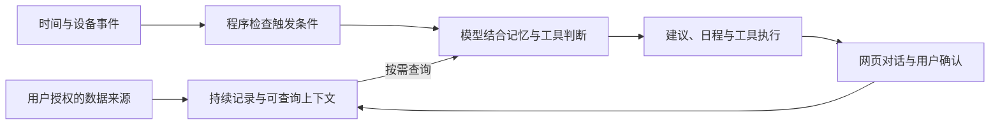

# Zigent

**Your Personal Agent with Giant Context**

Zigent 是一个可以自行部署、持续改造的个人 Agent 架构。它的目标是**有用且主动**：在理解你的生活、工作和当前状态之后，在合适的时候提供具体的建议、信息和行动。

精准的主动，需要足够广泛的上下文。你的项目正在推进什么，今天有哪些安排，最近睡得怎么样，手机刚收到什么重要通知，之前做过什么决定——这些信息共同决定了什么对你有用。

这里的 **Giant Context** 首先指持续积累的个人上下文：生活与工作中的信息、长期记忆和正在发生的事情。模型的上下文窗口是其中一项技术能力；系统还需要数据接入、持久化、检索、上下文整理和可靠执行，才能把这些信息用起来。

当前仓库是 **0.1 首版的私有审核版本**，根项目许可证待维护者决定。默认配置提供基础网页 Agent；下文提到的数据接入和高级集成按需配置，实际准备状态见 [功能支持表](docs/SUPPORT.md)。

## 为什么做一个可改造的个人 Agent

每个人需要的上下文、触发条件和工作方式都不同。研究者的项目文件、经常出差的人的日程、关注睡眠的人选择接入的健康指标，都需要不同的处理方式。

Zigent 希望把可复用的运行时做好，同时让使用者能借助 AI coding 快速添加自己的数据源、工具和行为规则。对话是入口，日常信息的获取和整理则尽量通过明确授权的数据接口自动完成，减少反复向 Agent 交代背景的负担。

个人 Agent 也可以把专业工作交给 Codex、Claude 等执行环境。它负责理解你的需求和上下文，选择何时委派、补齐必要背景、检查执行结果，并把结果带回持续的个人对话。

## 让主动建立在上下文上

一条值得看的提醒，应当与你当前的事情有关，也应当出现在合适的时间。

例如，在用户已接入相关数据并配置任务之后：

- 新的睡眠数据到达，结合近期记录和用户自己的计划，生成有依据的睡眠复盘。
- 到达某个地点，结合当时的安排触发一项跟进；离开或条件失效后取消不再适用的提醒。
- 项目中出现新资料或会议记录，通过登记的文件与文档工具查询背景，辅助整理下一步工作。
- 一项委派工作完成，把执行状态和结果带回原对话，再由用户决定下一步。

这些是可配置的使用场景。默认示例没有个人数据，也不会预先创建健康、地点或其他提醒任务。

系统中的分工是：

1. **后端持续记录，并提供工具。** 接收用户授权的数据，按 Agent 和账号范围保存；模型可以按需查询相关证据。
2. **程序判断触发条件。** 时间窗口、事件、去重、冷却和过期等条件由保存的配置与确定性逻辑执行。
3. **模型结合上下文判断内容。** 决定还需要查看什么，如何理解新信息，以及怎样形成具体的建议或行动。
4. **执行、确认并保留结果。** 通过网页操作、工具或专业执行器推进任务，把进度和结果留在可继续的对话中。



## 可以接入哪些上下文

| 上下文 | 仓库中已有的相关能力 | 使用条件 |
| --- | --- | --- |
| 对话、决定和个人偏好 | 会话历史、长期记忆、规则与技能维护 | 基础示例启用，内容由用户逐步积累 |
| 日程和待办 | Google Calendar、Todoist 等账号工具 | 用户自己的账号授权 |
| 项目、文档和会议记录 | 项目文件查询、文档读取、飞书文档、Drive、Notion、XMind 等适配 | 登记项目或授权对应服务；会议录音转录需额外配置 |
| 定位和地点事件 | 定位接收、区域/围栏触发和事件任务 | 自己的设备上报与任务配置 |
| Apple Watch 等来源的健康记录 | 健康数据接收、查询、日记、睡眠/HRV 等任务逻辑 | 用户明确授权的数据导出和私有存储配置 |
| iPhone 通知 | 通知内容接收、按 Agent 隔离保存和查询 | 自己的设备采集与接入凭据 |
| 编程和专业工作的进度 | Codex/Claude 适配、委派任务、状态与结果记录 | 自己的客户端、登录及执行环境 |
| 其他生活记录 | 对话、长期记忆、技能与可扩展接入 | 用户记录，或自行开发对应数据源 |

这些是已有源码和扩展入口。各项集成的启用、通用化及验收状态不同，不能由这张表推断它们已经自动接入。例如，委派任务的记录不等于自动导入一台电脑上的全部编程历史。详细状态见 [功能支持表](docs/SUPPORT.md)。

## 让上下文长期可用

相关代码的演进集中在几个具体问题上：

- **保存信息的归属与来源。** 会话、账号、任务和设备数据按范围隔离；历史查询保留分页与原始记录的关联。
- **按模型管理上下文。** 使用对应版本和供应商的窗口信息，按路线选择摘要或原生压缩，并保存可继续的上下文状态。
- **持续维护记忆。** 通过持久化记忆、历史查询和可检查的规则变更，让先前的决定能被后续工作使用。
- **让主动任务遵守时机。** 触发窗口、冷却、过期和设备时钟容差在共享逻辑中处理，模型调用和投递前重新判断适用条件。
- **区分执行进度和完成结果。** 委派、文件保存、预览与最终交付分别记录，避免把开始执行当作已经交付。

仓库同时包含网页交互、子 Agent、工具确认、使用量统计和通用文档/代码执行源码。高级能力的配置与支持范围持续整理中。

## 数据与自行部署

个人上下文可能包含定位、通知、健康、工作资料和账号信息。Zigent 采用自行部署的方式，让使用者选择接入什么、数据存在哪里、授权给谁，以及何时停止接入。

**自行部署不意味着数据永远不离开本机。** 调用外部模型、搜索或第三方工具时，选中的上下文、查询或文件可能发送给对应供应商。应根据自己的数据范围选择模型和工具，并审阅相关权限与服务条款。

仓库提供通用示例，不包含任何人的生产凭据、个人项目、会话数据或设备授权。默认高级集成关闭，运行时数据和本机秘密排除在 Git 同步之外。

## 开始使用

首版以 Node.js 24 LTS 为部署基线，源码最低版本声明为 22.5。准备自己的模型 API key、登录密码，以及提供 HTTPS 的 Caddy。

```bash
git clone https://github.com/zc-liu722/zigent-personal-agent.git
cd zigent-personal-agent
npm ci
cp .env.example .env
npm run setup:password
```

在 `.env` 中填写 `DEEPSEEK_API_KEY`，将密码工具输出的 `ASSISTANT_WEB_PASSWORD_HASH` 整行复制进去：

```bash
npm run check
npm run build
npm run start:prod -- assistant
```

默认 Agent ID 为 `assistant`，示例配置使用 `deepseek-v4.1flash-official`。后端监听 `127.0.0.1:8790`，另开终端启动本地 HTTPS：

```bash
caddy run --config ops/community/Caddyfile.local --adapter caddyfile
```

按 [本地 HTTPS 说明](docs/DEPLOYMENT.md#本地-https) 信任自己的本地证书后，打开 `https://localhost:8443/assistant/`。仓库目前私有，克隆需要访问权限。

Windows PowerShell、配置修改、启动后的验收与常见问题见 [安装指南](docs/GETTING_STARTED.md)。公网域名与 Linux 服务示例见 [部署说明](docs/DEPLOYMENT.md)。

## 开发与维护

`src/` 是运行时与集成；`web/` 是网页；`skills/` 保存通用技能；文档处理、编辑器和独立执行模块的相关源码在 `ops/` 中。

```bash
npm run dev -- assistant
npm run check
npm run build
npm run build:web
```

本地组件工作台使用 `npm run dev:components` 启动，组件聊天需要自己的本地登录。网页构建产物位于 `build/web/`，默认运行时仍读取仓库中的 `web/`。

维护源码通过逐文件清单和独立覆盖模板更新到本仓库，生产环境与社区构建分开。当前已准备 GitHub 托管的构建工作流，Actions 仍关闭。

| 进一步了解 | 文档 |
| --- | --- |
| 首版功能、平台及高级能力状态 | [功能支持表](docs/SUPPORT.md) |
| 运行时与目录结构 | [架构说明](docs/ARCHITECTURE.md) |
| 从维护源码生成更新 PR | [同步流程](docs/SYNC.md) |
| 项目许可与依赖分发决策 | [许可说明](docs/LICENSING.md) |
| 锁定依赖的声明及来源 | [依赖盘点](docs/DEPENDENCIES.md) |
| 正式公开前的剩余事项 | [审核清单](docs/RELEASE_REVIEW.md) |
