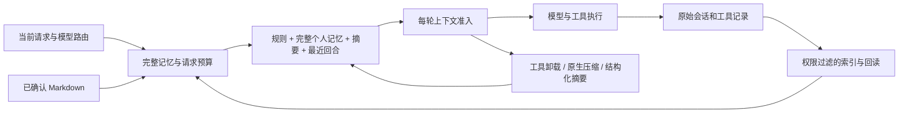

# Agent 记忆架构、调研与演进

调研日期：2026-10-28。目标是让 Agent 连续完成任务、准确找回依据、尊重最新纠正，并控制整个任务的开销。压缩率只是其中一个指标。本文区分已实现机制与后续设计；供应商自己的跑分不作为本系统的质量证明。

## 分层与事实来源

| 层 | 内容 | 进入模型的方式 |
| --- | --- | --- |
| 常驻规则 | Agent Soul、共享行为规则 | 稳定系统前缀，保留完整原文 |
| 个人记忆 | 已确认的偏好、事实、约束 | 私聊与授权后台任务完整加载原文，不按关键词或模型预算筛选 |
| 当前工作状态 | 目标、约束、决策、进度、证据、下一步 | 结构化摘要或供应商原生 checkpoint，加最近完整回合 |
| 历史证据 | 原始消息、工具调用与结果 | 历史索引搜索、逐段读取、当前运行结果回读 |
| 专题档案 | 低频长期细节 | 默认目录只放标题；按需搜索并读取指定版本 |

SQLite 历史与用户确认的 Markdown 是事实来源。索引、检索摘录和压缩摘要都是可重建的派生物。摘要不能授予权限、把尝试变成成功，或把自己的推断当成用户偏好。

## 调研亮点与适配

| 一手来源 | 值得吸收的设计 | Zigent 的取舍 |
| --- | --- | --- |
| [OpenAI Compaction](https://developers.openai.com/api/docs/guides/compaction)、[Memory Cookbook](https://developers.openai.com/cookbook/examples/agents_sdk/building_reliable_agents_memory_compaction) | 原生压缩保存不透明状态；会话延续与跨任务记忆分工 | 原生块绑定完整模型／供应商身份；供应商能力未经确认时用通用摘要，原生状态不写成个人事实 |
| [Anthropic Context Engineering](https://www.anthropic.com/engineering/effective-context-engineering-for-ai-agents) | 按需取回、结构化笔记、清理旧工具结果 | 清理必须有原文回读入口；摘要使用未清理来源；保护当前请求与完整工具交换 |
| [Pi Compaction](https://github.com/earendil-works/pi/blob/main/packages/coding-agent/docs/compaction.md) | 文件操作记录独立于自然语言摘要维护 | 程序生成来源账本，保存 turn/call、哈希、长度与失败状态；不让模型编造来源 |
| [OpenCode Compaction](https://dev.opencode.ai/v2/docs/compaction/) | 输出预留、近期保留与触发分别配置 | 延续按路由窗口、输出上限、保留量与安全余量；调用和 fallback 都检查预算 |
| [Letta Memory Blocks](https://docs.letta.com/v1-sdk/memory/memory-blocks)、[Archival Memory](https://docs.letta.com/v1-sdk/memory/archival-memory) | 常驻核心与外部档案分工；块有用途及容量 | 共享规则稳定，个人原文完整加载，专题档案按需读取 |
| [LangMem Concepts](https://langchain-ai.github.io/langmem/concepts/conceptual_guide/) | 事实、经历、程序规则分层；同步与后台巩固分工 | 已确认事实与自动摘要分开，避免会话压缩污染长期偏好 |
| [Mastra Observational Memory](https://mastra.ai/docs/memory/observational-memory) | Observer／Reflector、后台缓冲、边界激活和生命周期状态 | 本轮先补来源、版本、预算和诊断；后台生成需持久队列和版本比较再接入 |
| [Zep Provenance](https://www.getzep.com/blog/how-zep-tracks-provenance-in-agent-memory/)、[Graphiti](https://github.com/getzep/graphiti) | 原始 episode、多来源关联、事实有效时间与纠错历史 | 吸收可追溯原文和明确纠错；尚未实现事实图谱、多跳推理或事实级有效时间 |
| [Mem0 Add](https://docs.mem0.ai/core-concepts/memory-operations/add)、[Update](https://docs.mem0.ai/core-concepts/memory-operations/update) | 作用域、独立检索、显式更新及到期控制 | 当前官方 add 是追加语义，不照搬旧文章的自动覆写假设；继续用 revision 与确认补丁纠正 |
| [Manus Context Engineering](https://manus.im/blog/Context-Engineering-for-AI-Agents-Lessons-from-Building-Manus) | 稳定前缀、可恢复引用、保留失败证据 | 完整个人记忆放在固定参考上下文；同一运行的清理投影稳定；回读不重新执行工具 |
| [Factory Compression Evaluation](https://factory.com/news/evaluating-compression) | 结构化增量合并；优化任务总 token，跟踪事实／产物／决策／继续执行能力 | 增加压缩来源、代数、耗时和前后大小；质量目标包含找回成本，不能只追求短摘要 |

[LongMemEval](https://arxiv.org/abs/2410.10813) 区分信息提取、跨会话推理、时间推理、知识更新与知道何时无法回答，比单看相似度更接近我们的目标。[Lost in the Middle](https://arxiv.org/abs/2307.03172) 提醒我们区分可容纳长度与有效利用长度；该研究针对其当时模型，不能推出当前某个路由的最优阈值。

## 本轮实现

### 可恢复的压缩

按精确路由选择 `summary`、`openai-native`、`anthropic-native` 或 `runtime`。供应商窗口发现、输出预留、完整请求估算和有界错误恢复延续原实现。Codex 的内部工具循环由原生运行时管理，Zigent 不用保守冷启动估算覆盖它的原生窗口配置。

有 `conversation_history` 回读能力时才卸载旧工具输出。占位符给出调用 ID 与 SHA-256，`read_live_tool` 只读取当前运行已执行的结果，不接受其他会话、用户或文件选择。分页使用 Unicode 码点，支持期望哈希；重复 call ID 对应不同内容时拒绝猜测。回读与原工具执行是不同操作。

生成摘要始终使用未被占位符改写的来源。checkpoint 独立记录有限来源索引、来源总哈希、代数、触发原因、耗时及前后估算量，并明确省略的引用数量。哈希证明来源身份，不证明摘要语义完整。通用 checkpoint 每四代、旧版无来源元数据或不透明状态转通用摘要时，从当前运行仍持有的完整来源前缀重建；它不能恢复更早已被会话摘要替代的文本，旧会话需经历史工具检索。

原文、完整工具配对、当前输入和图像锚点继续保留。摘要分块考虑上一份摘要、输出及 reasoning 预留；不完整或未减小上下文的结果不推进边界。已完成摘要分块的实际用量不因后续校验失败而丢弃。

### 检索与读取

`conversation_history` 搜索支持短语、全部关键词、任一关键词，以及相关性／时间排序。SQLite FTS5 只索引默认可见正文与用户表单答案，支持中文及拉丁文本；thoughts、tools、commentary 仍需显式选择。结果保留会话、消息、回合与 part 来源，可逐段精确回读。

索引通过脏队列和可恢复游标分批维护，不在启动时全量重建；批次有工作量限制并让出执行线程。查询以实际会话权限与未删除原记录为准，索引不扩大权限。FTS 先取最多 200 个候选 ID，再和最多 100 条原文扫描候选合并，避免先加载所有命中正文。稳定截止点和 keyset 游标避免后台回填让翻页漏记录；候选指纹变化要求重新读取当前窗口。返回 `coverage.scan_cursor`／`next_scan_cursor`，先读完窗口内 `next_offset`，再进入下一窗口。相关性排名限定在候选内；单条巨型工具过程仍可能较慢，记录数限制不等于严格 CPU 时间界限。空结果不能证明历史不存在，参数细节以工具定义为准。

`long_term_memory.search` 检索已授权的个人档案、共享规则和专题档案，返回匹配摘录；继续搜索时核对同一 revision。读取正文时，`read` 返回完整个人记忆与共享规则，`read_archive` 按完整标题返回一篇专题档案全文，不提供正文分段读取。专题档案目录仍只含标题。

### 个人记忆全文加载与缓存

个人长期记忆在私聊与授权后台任务中完整加载，不再区分大小档案，不设 12%／6,000 token 的单独摘录预算，也不按核心关键词或当前问题相关性筛选。Soul 和共享规则仍完整加载；群聊仍不加载私人档案。关键词排序只用于模型显式调用的记忆搜索，不参与常驻个人记忆注入。

所有路径最终都将完整个人记忆计入请求预算。完整个人原文和档案目录放在固定参考上下文，不进入会话摘要；稳定规则保留在系统前缀。专题档案仍按需读取，使用 read_archive 按完整标题一次取回全文。Markdown 缓存按发布代与文件变化失效，避免重复读正文；确认和原子写入行为保持不变。

## 写入、纠错与删除

`long_term_memory.read` 返回原始 Markdown 与 revision，不返回条目索引。`replace` 使用唯一匹配的 `oldText/newText`，空新文本删除该段；`append` 追加原文；档案 `create/delete` 按完整标题操作。所有补丁针对同一原版本，重叠、缺失、歧义或 revision 变化整批拒绝。

移动到档案时，在同一提议中删除原段并创建／更新专题档案，确认后原子提交。用户可在现有网页操作区编辑。压缩不能批准提议或自动修改个人记忆，不给正文添加记账时间戳；事实自身的日期保留。

群聊不加载私人档案；历史检索私聊限定同一用户，群聊限定同一群。后台读取遵循原任务授权。用户编辑会话后旧分支不再进入普通检索和上下文，checkpoint 失效，已产生的计费记录保留。底层目录、发布代和编辑细节见 [memory README](README.md)。

## 后续阶段与进入条件

以下是设计规划，尚未宣称实现或验证：

1. **持久后台观察与反思**：任务表按 Agent／会话／路由隔离，保存来源边界、hash、base checkpoint version、租约、取消和重试状态。生成时继续使用旧有效 checkpoint，激活时比较版本；编辑或来源变化就淘汰旧结果，失败不前移边界。先记录同步压缩耗时，再判断是否值得额外模型调用。
2. **事实级时间与冲突**：正文外维护 evidence IDs、valid time、superseded-by，区分过去成立与当前已纠正。沿用确认写入，不让摘要静默改变偏好；实际出现关系查询需求后再评估图数据库。
3. **混合语义检索**：保留词法索引的 ID／错误码精确命中，按需增加已配置 embedding 和统一来源 ID 融合，保持权限过滤与删除失效。先明确供应商、隐私范围和开销，不擅自把私人历史发给新服务。
4. **路由自适应质量预算**：在获准样本上观察原文找回、约束／纠错保留、重复工具执行、错误成功声明、端到端耗时、任务总 token 与成本，再调整各路由阈值。仓库当前禁止自动测试；本轮采用代码审阅、类型检查、构建和生产元数据核验，没有把论文或他家跑分当成我们的结果。

后续复杂度由实际失败模式和可测收益决定。本轮无需新增框架、图数据库或向量服务。
